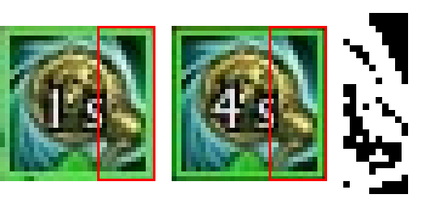

# olr

ArcheAge: One Last Ride 的钓鱼助手（AHK v2）。v0.04。

## 文件

- `olr_fishing.ahk`：钓鱼助手，双击运行。里面没有注释，改参数直接改数字。
- `FindText.ahk`：识图库（FeiYue 的 FindText v2 10.1），钓鱼脚本依赖它。
- `images/`：buff 原图，都是 32x32。
  - `buff_num4_1.jpg`～`buff_num8_1.jpg`：2026-11-26 夜里新截的活图标（右边 x=619，带倒计时白字），现在 4、5、6、8 号的图案就是用这 4 张做的，阈值 80。
  - 每个 buff 都有第二张图案：`buff_num4_4.png`～`buff_num8_4.png`（2026-11-26 傍晚裁的老图，偏暗一点，倒计时数字不一样）。两张都做成图案，任何一张对上就按，阈值都是 80。7 号先加的第二张（2026-11-27 16:00，确实提了成功率），4、5、6、8 号是 2026-11-27 晚上按同样办法加的。
  - `buff_blood.png`：血条（32x12 蓝条，阈值 125），用来判断有没有在钓鱼。
  - `buff4s_error.png`：红色向下箭头的 buff（鱼血条下 3 个 buff 里最右边那个），只认不按，出现时触发立刻扫描 5 个 buff。
  - `buff_num7_combo_right.png`、`buff_num8_combo_right.png`：7、8 号右边那条裁切的对照图（左：活图标原图，红框是裁切区；中：老图；右：二值化后的图案）。
- `tools/gen_buff_patterns.py`：从原图生成 FindText 图案的编码器（阈值 80），同时输出 `BuffText`、`BuffText2` 两块全图图案和 7、8 号的右边裁切图案。
- `tools/inject_buff_patterns.py`：把生成器输出的图案写进脚本，不用手工抄。

## 用法

- 按 `` ` ``（左上角 Esc 下面那个键）：整个脚本开启 / 暂停。暂停时钓鱼也停。
- 不用按 F5 开钓鱼：脚本每 500 毫秒找一次蓝条，找到就自动进入钓鱼模式，光标旁边提示「发现血条，钓鱼功能开启」；蓝条没了就自动退出钓鱼模式，提示「血条消失，钓鱼功能关闭」，同时响一声 KakaoTalk 风格的「叮咚」（880Hz 响 120 毫秒、659Hz 响 200 毫秒）。声音是 AHK 自带的 `SoundBeep`，从电脑的喇叭或耳机出来，跟游戏声音走同一个地方。
- 找蓝条不用固定像素点，按屏幕比例算搜索范围（横向 30%–70%，纵向 4%–20%），换分辨率也能找到；纵向留得比较宽，是为了窗口模式下游戏整体下移也能找到。
- 每次切换，鼠标光标旁边会出现提示，显示 2 秒就消失，不会一直留在光标处。

## buff 对应关系（小键盘数字键）

| buff | 按键 | 之后 |
| ---- | ---- | ---- |
| buff_num4 | 小键盘 4 | 等 2 秒按空格，再休息 2.9 秒 |
| buff_num5 | 小键盘 5 | 等 2 秒按空格，再休息 2.9 秒 |
| buff_num6 | 小键盘 6 | 等 2 秒按空格，再休息 2.9 秒 |
| buff_num7 | 小键盘 7 | 休息 5.1 秒 |
| buff_num8 | 小键盘 8 | 休息 5.1 秒 |

## 判断图片（脚本认的就是这些）

每个 buff 各有两张全图图案（jpg + png），任何一张对上就按，容错都是 0.2，阈值 80。5 号多一张全图（ScreenShot0011 里那条亮一点的鱼，见下面 buff_num5 一节）。**只有 7 号多一张右边一整条（12×32，x20–32）**，因为倒计时数字在图标中间偏左（x 9–14），右边这条完全碰不到数字。8 号的右边那条 2026-11-28 撤掉了（在 y=168 的地形上认到东西，见下面 buff_num8 一节）。

### buff_num4（小键盘 4）

  

左：活图标（2026-11-26 夜里，x=619）；中：老图；**右：第三张全图**（2026-11-28，她发来 Desktop.zip 的 8 张截图让我查为什么 4 号识别率低）。第三张是 ScreenShot0003 里上方中间那行 (620,76) 的 4 号——前两张图案对它误差 0.209–0.253，已经超过 0.2 容错，认不出来。第三张跟其他 buff 的分离度 0.427（最接近 8 号），安全线 0.2 以上，没问题。黑点 450/1024（44%），够密。注意：左上角玩家栏 (72,76) 那个疑似 4 号的图标没用——它对 4 号 0.254、对 8 号 0.263，分不清是谁，用了会认错。

### buff_num5（小键盘 5）

  

左：活图标；中：老图；**右：第三张全图**（2026-11-27 20:27，她发来 6 张含 5 号的截图让我挑）。第三张是 ScreenShot0011 里的那条鱼——它比前两张亮（平均灰度 140.9，前两张 132–137），阈值 80 下只有 142 个黑点，前两张图案认不出它（误差 0.367–0.415，超过 0.2 容错）。也就是说鱼图标亮一点的时候，前两张就找不到了，第三张就是补这个缺口的。分离度 0.310（最接近 7 号老图），安全线 0.2 以上，没问题。但它比前两张稀（14% 黑点），如果 5 号开始在不该出现的地方乱认，先怀疑这一张。另外 5 张里：0002、0013、0022 那三条跟前两张很像（误差 0.12–0.16），加了也没用；0004 那张带了个「2s」倒计时，误差 0.830，但倒计时每秒都在变，做成图案也没用，没要。

### buff_num6（小键盘 6）

 

左：活图标；右：老图。两张全图，没有第三张图案。

### buff_num7（小键盘 7）

 

左：活图标；右：老图。两张全图，**再加一张右边一整条**：

左：活图标，红框是裁切区（x20–32）；中：老图；右：二值化后的图案。黑点 109 个（28%），两张源图对上误差 0.047，对其他 buff 最接近 0.353。

### buff_num8（小键盘 8）

 

左：活图标；右：老图。两张全图，**右边那条已撤掉**（2026-11-28，见下）。

~~右边那条（12×32，x20–32）2026-11-28 撤掉了~~：日志 2026-11-28 05:24–05:38 里所有按 8 的都是错的——8 号全是在 y=168（或 y=318）找到的，而真正的 buff 栏在 y=207。7 号按完休息 5.1 秒的时候，脚本拿 8 号的右边那条在 y=168 那行（地形、树、石头）认到了东西，就按了 8。12 像素宽的细条太不经认，跟之前撤掉的「s」图案（10×12，也是在 y=168 认到东西）一个毛病。8 号现在只剩两张全图；7 号的右边那条没出过问题，留着。

### buff4s_error（红箭头，只认不按）

红色向下箭头（32x32，**阈值 80**，容错 0.3）。出现时不按任何键，只触发立刻扫描 5 个 buff。这是第一版的图（ScreenShot0004 里鱼血条下 3 个 buff 最右边那个，整张 32x32，不带层数）。阈值 80 下跟 5 个 buff 的分离度 0.506，安全线 0.3 以上，够用了。2026-11-27 20:19 曾经换成 ScreenShot0020 的新图（先是整张带 x4、阈值 60，后来改成 x4 下面那部分 32x20、阈值 40），2026-11-28 她让还原回第一版，图片和阈值都已还原。

### buff_blood（蓝条，判断有没有在钓鱼）

蓝条（32x12，阈值 125，容错 0.1）。每 500 毫秒找一次，找到就进入钓鱼模式，没了就退出。

（4、6 号原来也各加过一张裁切，但实测一直在出误差，2026-11-27 19:38 全部撤掉，只留两张全图：4 号试过底部、右边、顶部三张，6 号试过底部、右边两张——每一张都有问题，要么沾数字、要么太稀到处认、要么分离度不够。5 号的裁切也全撤了（顶部、底部、右边三张都有问题），但 5 号 2026-11-27 20:27 又加了一张**全图**（ScreenShot0011 里那条亮一点的鱼，不是裁切），见上面 buff_num5 一节。7 号的右边那条一直没出问题，留着；**8 号的右边那条 2026-11-28 也撤了**——在 y=168 的地形上认到东西，见上面 buff_num8 一节。）

「s」那组图案（add89c5 加的 BuffText3）已撤掉：它只有 10×12 那么小，实测在 buff 栏外面（y=168 那行）认到了东西，日志里 8 号在 1052,168、1019,168、1083,168 这些位置被找到——不是主 buff 栏那行（y=207），看着就像「该按 7 按了 8」。

## 判断逻辑

### 1. 蓝条进出钓鱼模式

`BloodCheck` 每 500 毫秒在屏幕比例范围（横向 30%–70%，纵向 4%–20%）里找蓝条：

- 找到 → 钓鱼模式开，提示「发现血条，钓鱼功能开启」。
- 没了 → 钓鱼模式关，清掉所有 buff 的休息计时，提示「血条消失，钓鱼功能关闭」，响一声「叮咚」。

### 2. 扫描

钓鱼开启后，4 个定时器每 10 毫秒轮流扫，互相错开约 2.5 毫秒，相当于每 2.5 毫秒扫一次上方条带（x 518–1165，y 0–392）找 5 个 buff 图标。找到一次后就记住位置，下次先在附近（上下 100 像素内）找，附近找不到再回条带里找。

### 3. 优先级（数字越小越优先）

1. **7、8 号**：先查这两个。找到就按，按完就停，等下一轮。
2. **buff4s_error（红箭头，不按）**：发现就立刻扫描 7、8、4、5、6 这几个图标，按扫描结果按键。
3. **4、5、6 号**：前面都没按到才查这三个。

同一个 buff 按完要休息（见下面），休息没满就算找到了也不按；不同的 buff 发现就立刻按。

### 4. 休息（每个 buff 各自计时）

按完一个 buff，那个 buff 自己休息一段时间，别的 buff 不受影响，各有各的计时器：

- 按空格的那三个（4、5、6 号）：休息 2.9 秒。
- 只休息的那两个（7、8 号）：休息 5.1 秒。

所以 7、8 号同时在的时候，各按一次就都休息，不会来回交替按个不停。以前是共用一个计时器，按 8 号会把 7 号的休息抹掉，两个同时在就每轮换着按、5.1 秒一次都没停过（2026-11-27 修掉）。

## 现在的参数（改数字就行）

| 参数 | 现在的值 | 说明 |
| ---- | ---- | ---- |
| ErrNum4 | 0.2 | 4 号容错 |
| ErrNum5 | 0.2 | 5 号容错 |
| ErrNum6 | 0.2 | 6 号容错 |
| ErrNum7 | 0.2 | 7 号容错 |
| ErrNum8 | 0.2 | 8 号容错 |
| ErrorErr | 0.3 | 红箭头 error 的容错 |
| BloodErr | 0.1 | 蓝条容错 |
| RestShort | 2900 | 按空格那三个的休息，毫秒（2.9 秒） |
| RestLong | 5100 | 7、8 号的休息，毫秒（5.1 秒） |
| ScanMs | 10 | 扫描间隔，毫秒 |
| NearR | 100 | 记住位置后先在附近找的范围，像素 |

图案阈值都是 80，血条图案阈值是 125。

## 日志

每次按键都会记到 `olr_fishing_log.txt`（脚本旁边），写明哪个 buff、按了哪个键、在哪找到的（附近还是条带）、哪一档对上的（p1 / p2 / p3 / p4）。
